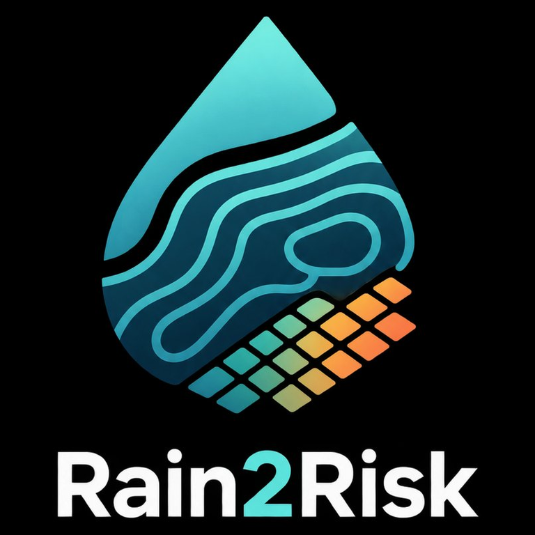
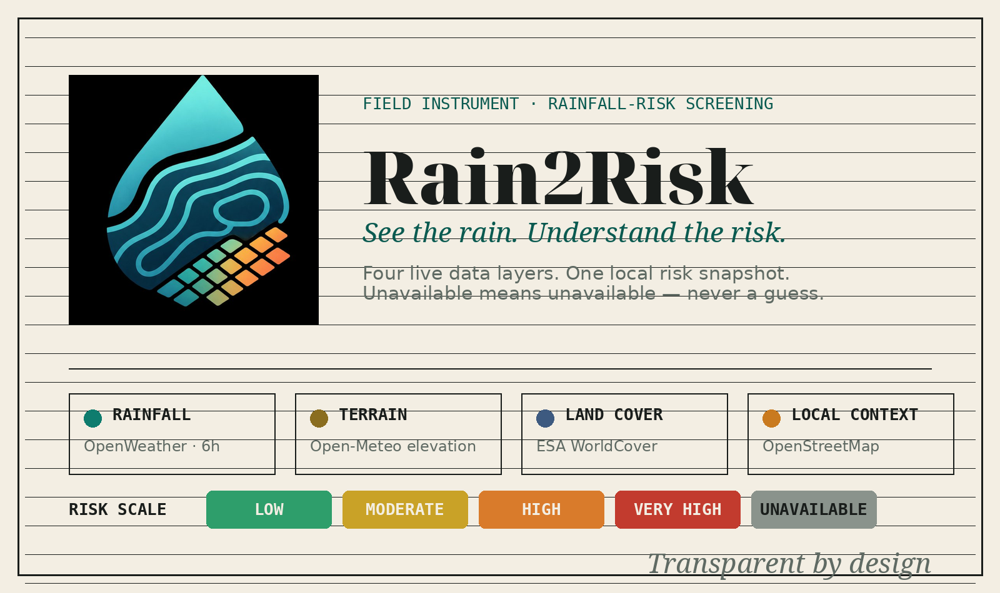

<p align="center">
  
</p>

<h1 align="center">Rain2Risk</h1>

<p align="center"><em>See the rain. Understand the risk.</em></p>

<p align="center">
  <a href="https://rain2risk.vercel.app/"></a>
  
  
</p>

<p align="center">
  <strong><a href="https://rain2risk.vercel.app/">▶&nbsp;Try the live demo</a></strong>
</p>

---

**Rain2Risk** is a field instrument for rainfall-risk screening. Select any point on Earth and it reads four live data layers into one transparent 0–100 score — a *screening*, not a warning. When data is missing, it writes **unavailable** instead of guessing. Never a forecast, never an emergency alert, and no machine learning.



## The four layers

Every score is built from the same four live sources — no invented values, ever.

| Layer | Source | What it tells us |
|---|---|---|
| **Rainfall** | OpenWeather · next 6 hours | Regional reference input |
| **Terrain** | Open-Meteo elevation | Height and slope of the land |
| **Land cover** | ESA WorldCover | What the surface is made of |
| **Local context** | OpenStreetMap | Buildings, water, urban surface nearby |

## The honesty rule

This is the core of the product, and of the brand:

- **Unavailable means unavailable.** A missing layer is shown as a gray dash — never as zero, never as green "safe".
- **A screening, not a warning.** For understanding and planning — not an official flood warning or emergency forecast.
- **Every score shows its reasoning.** Main contributors and data quality ship with each result.

## How it works

1. Click a place on the map (or use your location).
2. The app fetches the four layers for that point.
3. Terrain, cover and context are scored per map cell; rainfall acts as a regional reference.
4. You get a colored risk grid, a 0–100 score for your cell, and the full reasoning behind it.

### Risk scale

| Level | Color | Meaning |
|---|---|---|
| `LOW` | `#2E9E6B` | Low relative risk |
| `MODERATE` | `#C9A227` | Moderate relative risk |
| `HIGH` | `#D97B2B` | High relative risk |
| `VERY HIGH` | `#C23B2E` | Very high relative risk |
| `UNAVAILABLE` | `#8A938C` | Data missing — not a score |

## What was broken and how I fixed it

An honest changelog of the repair pass (October 2026). Each fix has a regression test.

### Bug 1: Every place showed 100/100 risk
**What broke:** The risk score was multiplied by 100 twice, so almost every place showed maximum risk — even with no rain.
**How I fixed it:** The weighted score is now divided by the total weight exactly once. A test asserts zero rain never yields a very-high score.

### Bug 2: Missing data looked like zero risk
**What broke:** Unavailable data rendered as 0 — as if the place were safe. Wrong and dangerous.
**How I fixed it:** Missing layers now render as `UNAVAILABLE`. The score is computed from available factors only, and the UI says so.

### Bug 3: Bad coordinates were accepted
**What broke:** Non-finite values like `NaN` could pass location validation.
**How I fixed it:** Coordinates must now be real, finite numbers — rejected otherwise.

### Bug 4: Wrong distance numbers
**What broke:** Distances used a flat-map formula. The Earth is round.
**How I fixed it:** Distances now use the haversine formula (correct on a sphere).

### Bug 5: Two users could break the cache
**What broke:** Concurrent requests could write to the same temporary cache file.
**How I fixed it:** Each write uses a unique temporary file name.

## Try it yourself

```bash
pip install -r requirements.txt
python backend/main.py
```

Rainfall needs a free OpenWeather key:

```bash
OPENWEATHER_API_KEY=your-key-here
```

Then open http://127.0.0.1:8000/ in your browser.

## API

- `POST /api/analyze` — send `{"lat": 36.8, "lon": 10.18}`, get the risk score, the map grid and data quality.
- `GET /api/health` — check that the app is running.

## Project structure

```
rain2risk/
├── frontend/          # The field-journal UI (map, panels, brand assets)
│   └── assets/        # logo-mark.png, logo-lockup.png, favicon.png
├── backend/           # Analysis pipeline: analyze.py → RiskResult
├── api/               # Vercel serverless entrypoint (+ static file serving)
├── docs/              # brand.md, brand-sheet.png, scan & operations notes
└── tests/             # Regression tests for every fixed bug
```

## Brand

Rain2Risk has its own visual identity — paper & ink, Fraunces + Plex Mono, the droplet-contour-grid mark. See [`docs/brand.md`](docs/brand.md) for the full guidelines.

## License

MIT — see [LICENSE](LICENSE).
